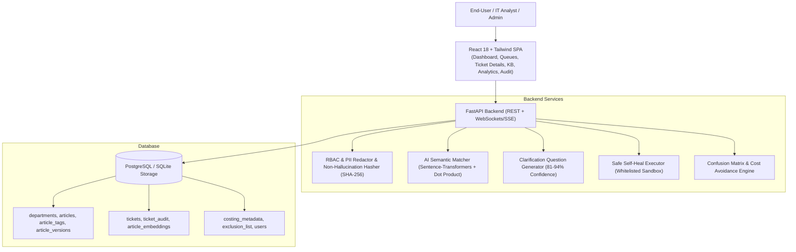

# BNP Paribas — Dynamic Recovery System

> **Enterprise AI-Assisted Incident Remediation & Knowledge Controller**  
> Built with **React (Vite + Tailwind CSS)**, **FastAPI (Python)**, **PostgreSQL / SQLite**, and **Sentence-Transformers AI**.

---

## Architecture Overview



---

## Confidence-Based Decision Flow Matrix

| Confidence Score | Triggered Action | UI Workflow & State |
|---|---|---|
| **= 100%** | **Instant Self-Heal** | Amber light triggers; "Self-Heal" button enabled; runs whitelisted automated script in sandbox, captures stdout/stderr into immutable audit log. |
| **$\ge$ 95%** | **Auto-Match with 5% Override** | Full SOP article displayed; analyst can click "Override 5%" to edit note and resolve ticket as `OVERRIDDEN`. |
| **81% – 94%** | **Dynamic Clarification (Ask More)** | Generates targeted clarification questions derived from near-matching article; analyst/user answers, appends to description & loops back to matcher. |
| **< 80%** | **Escalation** | Auto-flagged as `ESCALATED`; ticket is routed to the dedicated "Production-Support" queue for manual resolution. |

---

## Features Implemented

1. **AI Semantic Matching & Interpretability**:
   - Computes cosine similarity against knowledge-base articles across all 6 business domains.
   - Extracts and highlights the top-3 matching sentence fragments with rank and similarity contribution.
   - Fallback keyword/token overlap matcher.

2. **Non-Hallucination & Cryptographic Provenance**:
   - Computes deterministic **SHA-256** hash of every raw ticket and document ingestion.
   - Displays hash across all UI screens with live verification check button.
   - Embeds hashes into official downloadable **PDF Compliance Reports** and **CSV datasets**.

3. **Safe Self-Heal Automation**:
   - Whitelist verification in `/opt/selfheal/`.
   - Checks `exclusion_list` to prevent dangerous automation (e.g., Manual DB Shutdown).
   - Real-time terminal log viewer with return codes.

4. **Dynamic Q&A Clarification Loop (81% - 94%)**:
   - AI-generated contextual questions to resolve symptom ambiguity.
   - Appends user answers to description and re-triggers matcher in a loop.

5. **Executive Analytics & Confusion Matrix**:
   - 4x4 classification confusion matrix with accuracy, precision, recall, and F1.
   - Match-score distribution histogram.
   - Financial cost-avoidance ROI calculator (saved engineer hours * hourly rate).
   - Geographic ticket volume heatmap.

6. **Knowledge Base Version Control**:
   - Automatic version snapshotting on article edits.
   - 1-Click rollback to previous revisions.

7. **Client Self-Service (DIY) Portal**:
   - Real-time DIY troubleshooting suggestions as users type their issues.

---

## Quickstart & Local Execution

### Prerequisites
- Python 3.10+ (or Python 3.12/3.14)
- Node.js 18+ and npm

### 1. Backend Setup

```bash
# Navigate to project root
cd /path/to/project

# Create and activate virtual environment
python -m venv backend/venv
source backend/venv/bin/activate  # On Windows: backend\venv\Scripts\activate

# Install dependencies
pip install -r backend/requirements.txt

# Run backend server (Dual-mode: SQLite out-of-the-box or PostgreSQL via DATABASE_URL)
uvicorn backend.app.main:app --host 127.0.0.1 --port 8000 --reload
```

Backend API Swagger Docs: `http://127.0.0.1:8000/docs`  
Health Check: `http://127.0.0.1:8000/api/health`

### 2. Frontend Setup

```bash
cd frontend
npm install
npm run dev
```

Open browser at `http://localhost:3000` (or `http://localhost:5173`).

---

## Running Automated Tests

```bash
# Run backend pytest suite
pytest backend/tests -v
```

---

## Docker Deployment

```bash
docker-compose up --build -d
```

---

## Open-Source Software Licenses (Guardrail 14)

| Library / Component | License | Purpose |
|---|---|---|
| **FastAPI** | MIT | High-performance asynchronous API framework |
| **Uvicorn** | BSD-3-Clause | ASGI web server |
| **SQLAlchemy** | MIT | SQL toolkit and Object-Relational Mapper |
| **Scikit-Learn** | BSD-3-Clause | Machine learning, TF-IDF vectorizer, cosine similarity |
| **NumPy & Pandas** | BSD-3-Clause | Numerical processing and matrix manipulation |
| **ReportLab** | BSD | Programmatic PDF compliance report generator |
| **React & Vite** | MIT | UI frontend library & build tool |
| **Tailwind CSS** | MIT | Utility-first CSS framework |
| **Lucide Icons** | ISC | Modern iconography |
| **Recharts** | MIT | Data visualization and charts |
